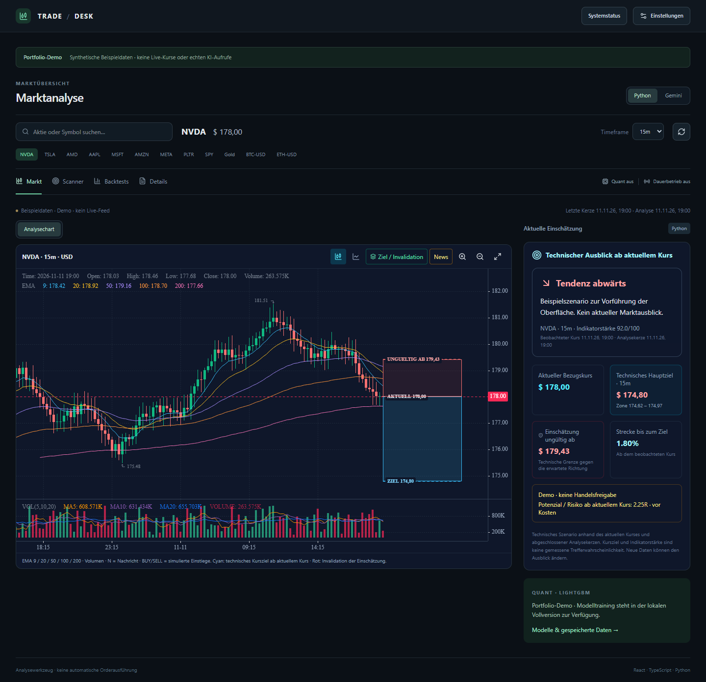

# Trade Desk

Eine Marktanalyse-Plattform mit interaktiven Charts, technischen Indikatoren
und getrennten Python- und KI-Analyseprofilen.

**[Öffentliche Demo öffnen](https://ziadelmoursi2008-ship-it.github.io/trade-desk/)**
 · **[Systemstatus](https://ziadelmoursi2008-ship-it.github.io/trade-desk/status/)**



## Funktionen

- Interaktiver Kerzenchart mit Instrumentensuche und sieben Zeitrahmen.
- Technische Analyse mit Trend-, Momentum-, Volumen- und Risikokennzahlen.
- Markt-Scanner mit Filtern für Richtung und Signalstärke sowie einer vollständigen Trefferliste.
- Lokale Vollversion: Gemini-Kontext, LightGBM-Filter, SQLite-Archive und Backtests.
- Kompakte Statusseite für Backend, Datenversorgung und Analysebetrieb.

## Öffentliche Demo und lokale Vollversion

Die kostenlose GitHub-Pages-Demo läuft im Browser mit **synthetischen Beispieldaten**.
Die technischen Indikatoren stammen aus der Python-Engine dieses Projekts; Kursziele
und Szenarien dienen ausschließlich zur Vorführung der Oberfläche. Es werden keine
Live-Kurse, echten KI-Antworten oder historischen Renditen vorgetäuscht.
Der Datenstand der Demo ist fest auf den 11. November 2026 gesetzt. Andere Zeitrahmen
zeigen dieselbe synthetische Kursfolge auf einer entsprechend skalierten Zeitachse.

Die lokale Vollversion verbindet das Frontend mit einer FastAPI-Anwendung. API-Schlüssel,
Datenbanken, trainierte Modelle, Laufzeitprotokolle und persönliche Archive gehören
nicht zum veröffentlichten Repository. Training und Dauerbetrieb werden in der lokalen
Anwendung ausdrücklich eingeschaltet. Das Projekt führt keine Broker-Orders aus.

## Technik

| Bereich | Technologien |
| --- | --- |
| Oberfläche | React, TypeScript, Vite, Tailwind CSS, KLineCharts |
| API | Python, FastAPI, WebSockets |
| Analyse | pandas, NumPy, LightGBM, optional Gemini |
| Speicherung | SQLite |
| Veröffentlichung | GitHub Actions und GitHub Pages |

## Demo lokal starten

Voraussetzungen: Node.js 24 und npm.

```sh
npm ci --prefix frontend
node tools/build-portfolio.mjs
python -m http.server 4173 --directory frontend/dist-portfolio
```

Danach `http://localhost:4173` öffnen. Zum Ansehen ist kein API-Schlüssel notwendig.
Für den letzten Befehl wird Python benötigt; alternativ funktioniert jeder statische Webserver.

## Vollversion lokal starten

1. Python-Umgebung anlegen und `backend/requirements.txt` installieren.
2. `backend/.env.example` nach `backend/.env` kopieren und bei Bedarf eigene Schlüssel eintragen.
3. `npm ci --prefix frontend` und `npm run build --prefix frontend` ausführen.
4. `node backend/observatory/build.mjs` ausführen.
5. Aus `backend/` mit `python -m uvicorn main:app --host 127.0.0.1 --port 8000` starten.

Status: `http://localhost:8000/` · Dashboard: `http://localhost:8000/trading`.
Die ausführliche Anleitung steht in [docs/LOCAL_GUIDE.md](docs/LOCAL_GUIDE.md).

## Validierung

```sh
npm test --prefix frontend
cd backend
python -m unittest test_system_status test_observatory -v
```

Die Frontend-Prüfungen kontrollieren unter anderem Chart-Markierungen, Datenstatus,
Analysedarstellung und Bedienung. Die Statusprüfungen sichern ab, dass ein erreichbares
Backend nicht mit einem funktionierenden Datenfeed oder einem aktiven KI-Dienst
gleichgesetzt wird.

Die Demo wird bei Änderungen an `main` automatisch gebaut und über GitHub Pages
veröffentlicht. Die synthetischen Daten lassen sich mit `python tools/create_demo_data.py`
aus der Python-Umgebung neu erzeugen; das Skript benötigt keine Netzwerkverbindung.
